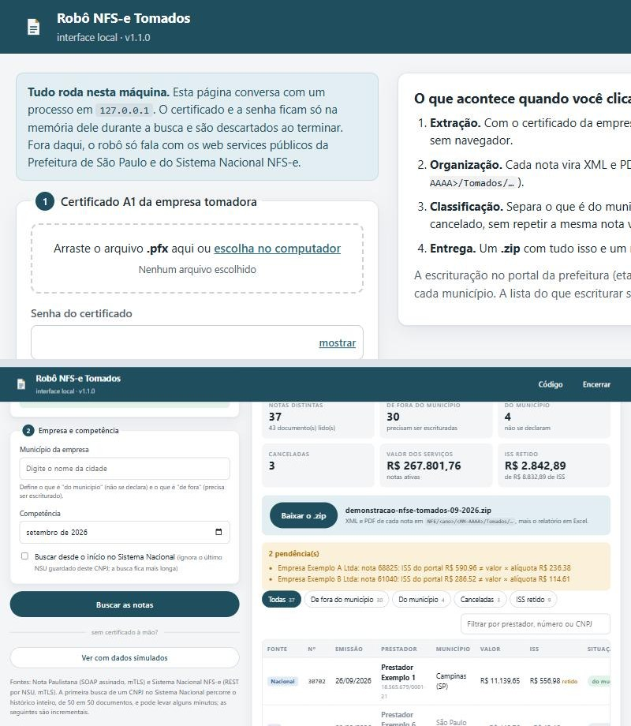

# Robô NFS-e — tomadas e prestadas

[](https://github.com/DiogusVincere/robo-nfse/actions/workflows/testes.yml)

Extrai, organiza e classifica as notas fiscais de serviço (NFS-e) que uma empresa **tomou** e as que ela
**prestou** no mês, lê de cada uma **o que foi retido** (ISS, INSS, IRRF, PIS, COFINS, CSLL) e escritura as
tomadas de fora do município — sem navegador e sem repetir nada do que já foi feito.

Versão de portfólio: o motor inteiro em um arquivo (`robo_nfse.py`), que mostra a estrutura e a lógica do robô
usado em produção num escritório contábil, sem credenciais, chaves, nomes de clientes nem endereços de sistemas
privados. Roda de ponta a ponta no modo `--demo`, com dados fictícios e um portal simulado, e tem uma **interface
local** (`--interface`, ou o executável da aba Releases) para buscar as notas de uma empresa de verdade com o
certificado A1 dela, sem que o certificado saia da máquina.

## O problema

Toda empresa que contrata um serviço (o **tomador**) precisa conhecer as NFS-e emitidas contra ela. Quando o
prestador é de **outro município**, a prefeitura do tomador não enxerga essa nota, e o tomador é obrigado a
declará-la ("escriturar") no portal da própria prefeitura, recolhendo o ISS quando ele é retido.

A mesma empresa, quando **presta** serviço, precisa saber o que cada cliente reteve do pagamento: ISS, INSS, IRRF
e as contribuições (PIS, COFINS, CSLL). É esse valor que ela abate na apuração do mês. A informação está nota a
nota, em campos cujo significado mudou em 2026, e somar errado vira imposto pago em dobro ou a menos.

Feito à mão, isso significa abrir portal por portal, empresa por empresa, todo mês: baixar o que existe em duas
fontes diferentes, descobrir o que é de fora, digitar nota a nota num formulário, guardar os comprovantes e
conferir retenção por retenção. É repetitivo, e um erro de digitação (número da nota, alíquota) só aparece
quando a fiscalização bate.

## O que o robô faz

Uma execução, ponta a ponta, para uma lista de empresas e uma competência:

| Etapa | O que acontece | Como |
|---|---|---|
| **1. Extração** | Busca as NFS-e **tomadas** e **prestadas** por cada empresa, 100% em segundo plano, com o certificado A1 dela | Nota Paulistana (SOAP assinado com XMLDSig + mTLS: `ConsultaNFeRecebidas` para as tomadas e `ConsultaNFeEmitidas` para as prestadas) e Sistema Nacional NFS-e (API REST por NSU, mTLS, incremental, com pausa, backoff e `Retry-After`; a distribuição devolve tudo em que o CNPJ aparece e o robô separa pelo papel) |
| **2. Organização** | Cada XML vai para a pasta do cliente na competência certa (competência = mês da **emissão**), em `Tomados/` ou `Prestados/`, com espelho em PDF | Reaproveita a pasta do mês que a equipe já tenha criado à mão (`09-2026`, `09.2026`, `092026`); documentos de outras competências, ou de um papel que não foi pedido naquela execução, são arquivados, não perdidos |
| **3. Classificação e retenções** | Nas tomadas, separa "do município" (não se declara), "fora do município" (precisa ser escriturada) e canceladas. Em toda nota, lê o que foi retido | Pelo código IBGE do município do **prestador**; deduplica a mesma nota vinda pelas duas fontes. As retenções saem dos campos do XML (ver [Retenções](#retenções)), nunca de cálculo |
| **4. Escrituração** | Declara no portal municipal as tomadas de fora | Consulta anti-duplicidade antes; travas antes de gravar (número do documento e ISS recalculado); salva o comprovante; confirma de novo no portal; renova a sessão se o portal derrubar |
| **5. Pós-escrituração** | Guia de ISS retido, exportação dos XML para o sistema contábil e relatório por responsável | Renumera os XML exportados (o portal troca o número da nota por um sequencial interno); Excel com três abas (Empresas, Notas, Retenções); e-mail opcional |

## Retenções

O que o tomador desconta do pagamento para recolher em nome do prestador. O robô **lê** cada valor do XML e
guarda num só formato (`Retencoes`), para as duas fontes e os dois papéis:

| Retenção | Nota Paulistana (SP) | Sistema Nacional |
|---|---|---|
| ISS | `ISSRetido` = true → `ValorISS` | `tpRetISSQN` 2 (pelo tomador) ou 3 (pelo intermediário) → `vISSQN`. O robô guarda **por quem**: a guia de ISS retido só sai para o que a própria empresa reteve |
| INSS (contribuição previdenciária) | `ValorINSS` | `tribFed/vRetCP` |
| IRRF | `ValorIR` | `tribFed/vRetIRRF` |
| PIS, COFINS, CSLL | Até 13/05/2026: `ValorPIS`, `ValorCOFINS`, `ValorCSLL`, cada um a própria retenção. **Desde 14/05/2026** (adaptação ao modelo nacional): `ValorPIS`/`ValorCOFINS` passaram a ser o débito próprio e `ValorCSLL` a **soma** das retenções de PIS, COFINS e CSLL | Pela NT SE/CGNFS-e 007, `tribFed/vRetCSLL` é a **soma** das retenções e `piscofins/tpRetPisCofins` diz quais entraram nela (3 = PIS+COFINS+CSLL, 4 = PIS+COFINS, 5 = PIS, 6 = COFINS, 7 = COFINS+CSLL, 8 = CSLL, 9 = PIS+CSLL). Na regra antiga (código 1, ainda usada por alguns provedores municipais) os valores retidos de PIS e COFINS vêm em `vPis`/`vCofins` e `vRetCSLL` é só a CSLL |

Quando o leiaute separa os três, cada um vai para o seu campo (`pis`, `cofins`, `csll`). Quando ele só traz a
soma, ela fica em `csrf` e `csrf_quais` diz o que está dentro ("PIS+COFINS+CSLL", "COFINS+CSLL"…). Quando o
código aponta um tributo só (5, 6, 8), a "soma" vai direto para o campo dele.

O Nacional também informa o total das retenções (`infNFSe/valores/vTotalRet`) e o líquido (`vLiq`). O robô
compara o total informado com a soma que leu e, se não bater, marca a nota com **"conferir"** no relatório, na
interface e no espelho em PDF. Nada é deduzido: se o XML não traz a retenção, ela não existe para o robô.

O Excel ganhou a aba **Retenções**: uma linha por empresa × papel, com a soma de cada tributo. Nas tomadas é o
que a empresa recolhe; nas prestadas, o que os clientes retiveram e ela abate.

## Decisões de projeto

- **Idempotência.** Toda etapa pode ser repetida sem duplicar nada: o último NSU por CNPJ fica guardado; antes de
  emitir, o robô consulta o que o portal já lista e o seu próprio *ledger* de chaves escrituradas. Rodar duas vezes
  só gera "já escriturada".
- **Falha isolada.** Erro numa empresa vira linha de pendência no relatório e o robô segue para a próxima. Nada
  interrompe o lote.
- **Segurança do A1.** O CNPJ é lido **de dentro** do certificado (CN ou `otherName` ICP-Brasil), não do nome do
  arquivo. A chave privada só existe em PEM temporário durante a sessão mTLS e é apagada ao sair do contexto. Senhas
  vêm de um provedor configurável (variável de ambiente, cofre), nunca do código.
- **Gentileza com os serviços públicos.** Pausa entre chamadas e entre empresas, backoff em 429/5xx, respeito ao
  `Retry-After`, paginação até acabar.
- **Travas antes de gravar.** O formulário é preenchido e **lido de volta** antes de confirmar: o número do documento
  tem de ser o da nota e o ISS que o portal calculou tem de bater com valor × alíquota (tolerância de R$ 0,01). Isso
  pega, por exemplo, a alíquota padrão do portal que não foi trocada pela da nota. O que não passa é descartado e
  vira pendência, nunca gravado errado.
- **Retenção é lida, nunca deduzida.** O robô mostra o que o XML diz, guarda quem reteve o ISS e avisa quando o
  total informado pelo Nacional não fecha com a soma.

## Demonstração offline

```
pip install -r requirements.txt
python robo_nfse.py --demo --saida ./demo
```

Seis empresas fictícias, notas tomadas e prestadas geradas com semente fixa (as mesmas a cada execução), retenções
federais ao acaso (INSS 11%, IRRF 1,5%, CSRF 4,65%) e um portal simulado em memória que, de propósito, tem um
"defeito": aplica alíquota padrão de 5% em 1 de cada 7 notas, e às vezes derruba a sessão. Primeira execução:

```
15:53:29 [1/6] 100 Empresa Exemplo A Ltda: 9 tomada(s), 6 prestada(s), 7 escriturada(s), R$ 5430.74 retido(s) nas prestadas  (faltam ~1s)
15:53:29 [2/6] 101 Empresa Exemplo B Ltda: 8 tomada(s), 3 prestada(s), 6 escriturada(s), R$ 1448.94 retido(s) nas prestadas  (faltam ~0s)
15:53:29    sessão caiu (tentativa 1) — renovando e refazendo a nota 96034
15:53:29 [3/6] 102 Empresa Exemplo C Ltda: 3 tomada(s), 4 prestada(s), 3 escriturada(s), R$ 5658.24 retido(s) nas prestadas  (faltam ~0s)
15:53:29 [4/6] 103 Empresa Exemplo D Ltda: 3 tomada(s), 5 prestada(s), 3 escriturada(s), R$ 5547.37 retido(s) nas prestadas  (faltam ~0s)
15:53:29 [5/6] 104 Empresa Exemplo E Ltda: 8 tomada(s), 4 prestada(s), 0 escriturada(s), R$ 1466.65 retido(s) nas prestadas  (faltam ~0s)
15:53:29 [6/6] 105 Empresa Exemplo F Ltda: 6 tomada(s), 2 prestada(s), 0 escriturada(s), R$ 77.63 retido(s) nas prestadas  (faltam ~0s)
15:53:30 relatório: demo\_relatorios\Analista 1 09-2026.xlsx
15:53:30 relatório: demo\_relatorios\Analista 2 09-2026.xlsx
```

A sessão derrubada foi renovada e a nota refeita. As empresas 104 e 105 são de outros municípios: suas tomadas
de fora aparecem no relatório como "escriturar no portal do tomador", não neste portal. As prestadas nunca são
escrituradas; o que importa nelas é a coluna de retenções.

Segunda execução, na mesma pasta:

```
15:53:56 [1/6] 100 Empresa Exemplo A Ltda: 9 tomada(s), 6 prestada(s), 0 escriturada(s), 7 já escriturada(s), R$ 5430.74 retido(s) nas prestadas  (faltam ~0s)
15:53:56 [2/6] 101 Empresa Exemplo B Ltda: 8 tomada(s), 3 prestada(s), 0 escriturada(s), 6 já escriturada(s), R$ 1448.94 retido(s) nas prestadas  (faltam ~0s)
15:53:56 [3/6] 102 Empresa Exemplo C Ltda: 3 tomada(s), 4 prestada(s), 0 escriturada(s), 3 já escriturada(s), R$ 5658.24 retido(s) nas prestadas  (faltam ~0s)
15:53:56 [4/6] 103 Empresa Exemplo D Ltda: 3 tomada(s), 5 prestada(s), 0 escriturada(s), 3 já escriturada(s), R$ 5547.37 retido(s) nas prestadas  (faltam ~0s)
15:53:56 [5/6] 104 Empresa Exemplo E Ltda: 8 tomada(s), 4 prestada(s), 0 escriturada(s), R$ 1466.65 retido(s) nas prestadas  (faltam ~0s)
15:53:56 [6/6] 105 Empresa Exemplo F Ltda: 6 tomada(s), 2 prestada(s), 0 escriturada(s), R$ 77.63 retido(s) nas prestadas  (faltam ~0s)
```

Nada do que foi gravado é gravado de novo. Quando a trava barra uma nota na primeira execução (o "defeito" do
portal: `ISS do portal R$ 50.00 ≠ valor × alíquota R$ 20.00`), ela ganha nova chance na segunda; o teste
`test_demonstracao.py` roda três vezes com um portal de semente fixa e confere exatamente isso.

O que a demonstração deixa em `./demo`:

```
demo/
├── 100 - Empresa Exemplo A Ltda/NFE/2026/09-2026/
│   ├── Tomados/
│   │   ├── Tomados SP/Autorizadas/            XML (e PDF, com reportlab) de cada nota tomada da fonte SP
│   │   ├── Tomados Portal Nacional/Autorizadas/  idem, fonte Nacional (há também Canceladas/)
│   │   ├── Notas Escrituradas/                comprovante PDF de cada nota declarada
│   │   ├── Importação XML Tomados/            XML exportados e renumerados para o sistema contábil
│   │   └── Guia ISS retido 09-2026.pdf
│   └── Prestados/
│       ├── Prestados SP/Autorizadas/          XML (e PDF) de cada nota que a empresa emitiu, pelo nome do tomador
│       └── Prestados Portal Nacional/Autorizadas/
├── ... (uma pasta por empresa)
├── _estado/estado.json                        último NSU por CNPJ + ledger do que já foi escriturado
└── _relatorios/Analista 1 09-2026.xlsx        um Excel por responsável: abas Empresas, Notas e Retenções
```

## Interface local



```
python robo_nfse.py --interface
```

Abre no navegador uma página servida por este mesmo processo, em `127.0.0.1`. A pessoa escolhe o `.pfx` da empresa,
digita a senha, escolhe o município, a competência e **o que buscar** (tomadas, prestadas ou as duas) e clica em
"Buscar". O servidor roda as etapas 1 a 3 do robô numa thread, mostra o andamento ao vivo e devolve um **.zip** com
a árvore `NFE/<ano>/<MM-AAAA>/Tomados/…` e `…/Prestados/…`, os XML, os PDFs e o Excel, além da lista de notas na
tela: papel, fonte, prestador ou tomador, valor, ISS e cada retenção lida (com "conferir" quando o total do XML não
fecha), com filtros por tomadas, prestadas, de fora, do município, com retenção e canceladas. Sem certificado à
mão, o botão **"Ver com dados simulados"** roda a demonstração offline pela mesma tela.

Para quem não tem Python: a aba [Releases](https://github.com/DiogusVincere/robo-nfse/releases) tem o pacote
portátil para Windows (`Robo NFSe.exe` + `_internal\`, montado por `build\empacotar.py` com o PyInstaller). É
descompactar e abrir; o navegador abre sozinho. `--sem-navegador` sobe a página sem abri-lo.

O que foi pensado para o certificado:

- O processo só escuta em `127.0.0.1` e a API exige um token aleatório gerado a cada execução, embutido na página.
  Um site aberto em outra aba não consegue lê-lo, então não consegue chamar a API.
- O `.pfx` vai para um arquivo temporário só durante a busca e é apagado no `finally`; a senha fica num
  `SenhaProvider` em memória e é esquecida ao terminar; a chave privada em PEM só existe dentro do `sessao_mtls`.
  Nada do certificado entra em log.
- O que fica no disco de quem usa, de propósito: as notas baixadas e o último NSU de cada CNPJ, em
  `%LOCALAPPDATA%\RoboNFSe` (pastas `saida` e `estado`), para a próxima busca do mesmo CNPJ ser incremental.
  A opção "buscar desde o início" descarta o NSU guardado. Quem vinha da versão 1.x (`RoboNFSeTomados`) tem a pasta
  renomeada na primeira abertura.

A escrituração (etapa 4) não entra na interface, pelo mesmo motivo da linha de comando: depende do portal de cada
município (ver "Limitações").

## Uso real

```
python robo_nfse.py --competencia 09/2026 --empresas empresas.json --certificados ./certificados --saida ./saida
```

Opções: `--competencia MM/AAAA` (padrão: o mês anterior), `--responsavel "Nome"` (só as empresas daquela pessoa),
`--so tomadas` ou `--so prestadas` (padrão: as duas).

**Variáveis de ambiente** (nenhum segredo fica em arquivo):

| Variável | Para quê |
|---|---|
| `NFSE_PFX_SENHA_<CNPJ>` | Senha do `.pfx` de cada empresa; `<CNPJ>` com 14 dígitos (ex.: `NFSE_PFX_SENHA_15881399000134`) |
| `NFSE_SMTP_HOST`, `NFSE_SMTP_PORTA` (padrão 587), `NFSE_SMTP_USUARIO`, `NFSE_SMTP_SENHA` | Envio do relatório por e-mail (STARTTLS). Sem elas, o relatório só é salvo |
| `NFSE_EMAIL_PARA` | Destinatário do relatório |

**`empresas.json`** (ver [`exemplos/empresas.exemplo.json`](exemplos/empresas.exemplo.json)): uma lista de objetos
com `codigo`, `razao`, `cnpj` (só dígitos), `municipio_ibge` (7 dígitos) e `responsavel`. Campos extras são
ignorados.

```json
[
  {"codigo": "100", "razao": "Empresa Exemplo A Ltda", "cnpj": "15881399000134",
   "municipio_ibge": "3509502", "responsavel": "Analista 1"}
]
```

**Pasta de certificados:** qualquer árvore de subpastas com arquivos `.pfx`. O robô abre cada um com a senha do
ambiente, lê o CNPJ de dentro do certificado e usa, para cada empresa, o **mais recente ainda válido**. O nome do
arquivo ou da pasta não é levado em conta.

**Município do portal:** `Config.municipio_escrituracao_ibge` (padrão `3509502` no código) é o município do portal
de escrituração. Só empresas desse município têm as tomadas de fora escrituradas; as outras recebem no relatório a
lista do que escriturar.

**Sem um `PortalMunicipal` implementado** (a situação desta versão: `main()` passa `portal=None`), o robô faz as
etapas 1 a 3 e o relatório: extrai das duas fontes, organiza as pastas, classifica, lê as retenções e lista nota a
nota o que precisa ser escriturado. A escrituração (etapa 4) e a exportação (etapa 5) exigem uma implementação da
interface descrita abaixo, que no robô de produção conversa com o portal JSF de uma prefeitura e depende da
autenticação de cada escritório.

## Arquitetura

O arquivo tem 14 seções, em ordem de dependência. No robô de produção cada uma é um módulo:

| Seção | Conteúdo | Principais nomes |
|---|---|---|
| 1 | Configuração e utilitários | `Config` (com `papeis`), `Competencia`, `para_float`, `nome_seguro`, `local`, `grupo` |
| 2 | Modelos | `Empresa`, `Retencoes` (ISS e por quem, INSS, IRRF, PIS, COFINS, CSLL, CSRF; `total`, `quais`, `divergencia`), `Nota` (o mesmo formato para as duas fontes e os dois papéis; `identidade` para deduplicar; `contraparte`), `ResultadoEmpresa`, `CODIGOS_RET_PIS_COFINS`, `SP_CSRF_SOMADA_DESDE` |
| 3 | Certificado A1 e mTLS | `SenhaProvider`/`SenhaDoAmbiente`, `ler_certificado`, `certificados_por_cnpj`, `sessao_mtls` |
| 4 | Assinatura XML (XMLDSig enveloped, RSA-SHA1) | `assinar_enveloped` |
| 5 | Clientes dos web services | `ClienteSaoPaulo` (SOAP, paginado; `consultar_recebidas` e `consultar_emitidas`), `ClienteNacional` (REST por NSU, backoff) |
| 6 | Leitura dos XML → `Nota`, com as retenções | `nota_de_sp`, `nota_nacional`, `retencoes_de_sp`, `retencoes_nacional`, `papel_de`, `chaves_canceladas` |
| 7 | Pastas e estado | `pasta_da_competencia`, `EstadoRobo` (NSU, ledger, arquivo; gravação atômica) |
| 8 | Espelho em PDF (opcional) | `gerar_espelho_pdf` (só com `reportlab`) |
| 9 | Classificação | `deduplicar`, `classificar` |
| 10 | Escrituração: interface + travas | `PortalMunicipal`, `Previa`, `SessaoPerdida`, `conferir_antes_de_gravar`, `escriturar_empresa` |
| 11 | Exportação para o sistema contábil | `renumerar_xml`, `exportar_para_sistema_contabil` |
| 12 | Relatório e e-mail | `gerar_relatorio` (openpyxl, três abas), `enviar_por_email` |
| 13 | Orquestrador | `extrair_empresa`, `salvar_xmls`, `situacao_da_prestada`, `executar`, `Progresso` |
| 14 | Demonstração e linha de comando | `PortalSimulado`, `retencoes_ficticias`, `demonstracao`, `cnpj_ficticio`, `carregar_empresas`, `papeis_de`, `main` |

**A interface `PortalMunicipal`** é o que o robô precisa de qualquer portal de escrituração; as travas e a lógica de
sessão (`escriturar_empresa`) valem para qualquer implementação:

| Método | Papel |
|---|---|
| `abrir_sessao(empresa)` | Autentica (ou renova a sessão, depois de um `SessaoPerdida`) |
| `escrituradas(empresa, competencia) -> set` | Identidades (CNPJ do prestador, nº, valor) já declaradas no mês: a consulta anti-duplicidade e a confirmação final |
| `preencher(empresa, nota) -> Previa` | Preenche o formulário e devolve o que o portal mostra (nº do documento, ISS calculado), **sem gravar** |
| `gravar() -> bytes` | Confirma o formulário preenchido e devolve o comprovante em PDF |
| `descartar()` | Abandona o formulário (a trava não deixou gravar) |
| `emitir_guia_iss_retido(empresa, competencia) -> bytes | None` | Guia do ISS retido do mês |
| `exportar_xml_tomados(empresa, competencia) -> (xmls, mapa)` | XML exportados pelo portal e o mapa {sequencial do portal: nº real do documento} |

`PortalSimulado` (seção 14) é uma implementação completa em memória, usada na demonstração e nos testes.

**A interface local** fica fora do arquivo do motor, em `interface/`: `servidor.py` (servidor HTTP da biblioteca
padrão, API JSON, a busca numa thread, o zip) e `web/` (`index.html`, `app.js`, `estilo.css` e a lista de
municípios do IBGE). Ela só usa o que o motor expõe: `ler_certificado`, `Config`, `Empresa`, `executar` (com a
lista `resultados`) e `demonstracao`. `build/` tem a receita do PyInstaller e o `empacotar.py` que gera o zip da
aba Releases.

## Fontes públicas

Os dois web services que o código consulta são públicos e documentados pelos próprios órgãos. Ambos exigem o
certificado A1 da empresa (mTLS) — hoje não existe acesso por procuração do contador às APIs do Sistema Nacional.

- **Nota Paulistana (Prefeitura de São Paulo)**: SOAP 1.1 em `https://nfe.prefeitura.sp.gov.br/ws/lotenfe.asmx`,
  operações `ConsultaNFeRecebidas` (notas tomadas) e `ConsultaNFeEmitidas` (notas prestadas), ambas com a mesma
  mensagem `PedidoConsultaNFePeriodo` assinada (XMLDSig enveloped, RSA-SHA1) e enviada como texto dentro de
  `MensagemXML`; o `SOAPAction` é `http://www.prefeitura.sp.gov.br/nfe/ws/consultaNFeRecebidas` /
  `…/consultaNFeEmitidas`. Até 50 notas por página; o cliente segue até uma página vir com menos de 50.
- **Sistema Nacional NFS-e (Ambiente de Dados Nacional)**: REST em
  `https://adn.nfse.gov.br/contribuintes/DFe/{NSU}?lote=true&cnpjConsulta={CNPJ}`, que devolve até 50 documentos
  a partir do NSU pedido (XML em base64, às vezes gzip) em que o CNPJ aparece como tomador, emitente ou
  intermediário. Os eventos de cancelamento chegam pela mesma distribuição. O cliente guarda o último NSU por CNPJ
  e trata 404 como "nada novo", 429/5xx com backoff e `Retry-After`.

## Testes

```
python -m unittest discover -s tests -v
```

112 testes, nenhum acesso à rede, tudo em pastas temporárias (passam no Windows e no Linux). O que cobrem:

| Arquivo | Cobre |
|---|---|
| `test_utilitarios.py` | `Competencia` (os três formatos de texto, mês anterior, fim de fevereiro, pasta), `para_float` (pt-BR e en), `nome_seguro`, `digitos`, `local`/`grupo`, `cnpj_ficticio` (dígitos verificadores) |
| `test_leitura_xml.py` | `nota_de_sp` e `nota_nacional` com XMLs sintéticos (alíquota 0.05 → 5%, `dhProc` antes de `dhEmi`, chave pelo `Id` NFS…, papel pelo CNPJ da empresa, prestador em `infDPS/prest` quando `tpEmit` é 2 ou 3); **as retenções**: SP antes e depois de 14/05/2026, Nacional com os códigos 0–9 do `tpRetPisCofins` (soma pela NT 007, um tributo só, regra antiga, só CSLL), ISS pelo intermediário, `vTotalRet` divergente vira "conferir", `vLiq`; `Nota.__post_init__`; `chaves_canceladas`, `renumerar_xml`, montagem do pedido SOAP e dos envelopes das duas operações, decodificação base64/gzip |
| `test_classificacao.py` | `classificar` (do município × fora × canceladas; dedup entre fontes com preferência pela Nacional) e `conferir_antes_de_gravar` (número diferente, ISS fora da tolerância, ok) |
| `test_estado.py` | `EstadoRobo` (NSU monotônico, ledger, arquivar/arquivadas, gravação atômica), `pasta_da_competencia` reaproveitando `09.2026`/`092026`/`09 2026`, `salvar_xmls` em `Tomados/` e `Prestados/` (prestada pelo nome do tomador, ou pelo CNPJ quando não há nome) |
| `test_relatorio.py` | `gerar_relatorio` (três abas; confere cabeçalhos, a linha de uma tomada e de uma prestada com retenções, e a aba Retenções), espelho em PDF com e sem reportlab, e-mail sem configuração não envia, `Progresso`, `papeis_de` |
| `test_escrituracao.py` | `extrair_empresa` com um Nacional de mentira (papel não pedido vai para o arquivo do estado e volta quando é pedido; outra competência idem); `PortalSimulado` + `escriturar_empresa`: a trava barra o "defeito" 1 em 7, sessão perdida é renovada (e vira pendência quando nunca volta), ledger e consulta ao portal impedem duplicar, guia só com ISS retido, gravação não confirmada vira aviso; exportação renumerada; `executar` sem portal (tomadas e prestadas, dedup das prestadas, retido nas prestadas), com falha isolada e com empresa de outro município |
| `test_demonstracao.py` | `demonstracao()` três vezes na mesma pasta com portal de semente fixa (2ª: só as barradas são gravadas, o resto "já escriturada"; 3ª: zero gravações), a demonstração como ela é, `main --demo`, `carregar_empresas` com o arquivo de exemplo |
| `test_interface.py` | A interface local de verdade, pela rede local: página com o token, API sem token = 403, conferência do certificado (ok, senha errada, arquivo inválido, nada fica no disco), validações da busca (inclusive `papeis`), busca simulada com zip, busca "real" com fontes falsas (uma tomada de SP, uma tomada e uma **prestada** do Nacional com INSS, IRRF e CSRF; totais, retenções no JSON, nomes dos arquivos no zip, saída persistente, segunda busca incremental e terceira só com tomadas), 409 para busca concorrente, `/api/encerrar` e a migração da pasta `RoboNFSeTomados` → `RoboNFSe` subpasta a subpasta |
| `test_certificado.py` | Certificados autoassinados gerados no teste pela `cryptography` (RSA 2048, PFX em memória): `assinar_enveloped` (estrutura `Signature/SignedInfo/Reference URI=""`, `DigestValue` = SHA-1 do C14N do documento sem a assinatura, assinatura verificada com a chave pública, adulteração detectada), `ler_certificado` pelo CN e pelo `otherName` ICP-Brasil, `certificados_por_cnpj` pulando o vencido, `sessao_mtls` criando e apagando os PEM |

O workflow [`testes.yml`](.github/workflows/testes.yml) roda a suíte em Python 3.12 e 3.13 (Ubuntu), depois a
demonstração duas vezes e confere os dois relatórios.

## Limitações

- **O portal municipal real não está incluído.** `PortalMunicipal` é só a interface (a abstração do código); a
  implementação de produção depende da autenticação e do portal de cada prefeitura. Sem ela, o robô extrai,
  organiza, classifica, lê as retenções e relata.
- **Certificado de cada empresa.** As APIs do Sistema Nacional só aceitam certificado com a mesma raiz de CNPJ do
  contribuinte; não há procuração do contador. Sem o A1 da empresa, não há coleta.
- **Só o que está no padrão nacional ou na Nota Paulistana.** Nota emitida pelo sistema próprio de outra
  prefeitura (e não compartilhada com o Ambiente de Dados Nacional) não aparece.
- **PIS/COFINS/CSLL na Nota Paulistana depois de 14/05/2026.** O XML que o web service devolve traz a soma em
  `ValorCSLL`, sem dizer quais contribuições a compõem; o robô registra a soma como CSRF (PIS+COFINS+CSLL).
- **RSA-SHA1** na assinatura XML é exigência do web service da Prefeitura de São Paulo, não uma escolha.
- **Sem *retries* no SOAP**: o cliente de SP levanta o erro na primeira falha HTTP (o cliente Nacional tem backoff).
  No orquestrador, a falha fica isolada na empresa.
- O espelho em PDF depende do `reportlab` (opcional); sem ele, só o XML é salvo.
- O CNPJ em `empresas.json` precisa vir só com dígitos: é comparado como texto com o CNPJ lido dos XML.

## Licença

[MIT](LICENSE).
